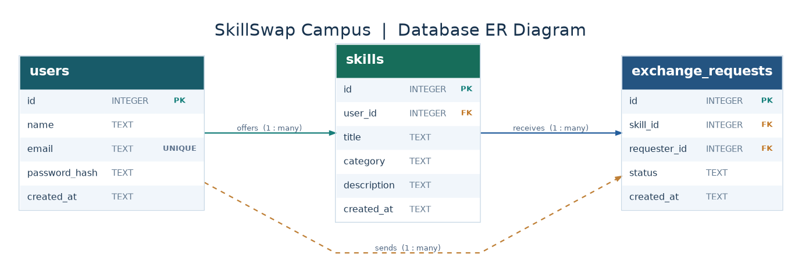

# SkillSwap Campus

## Peer-to-Peer Learning and Skill Exchange Platform

SkillSwap Campus is a web-based application developed as a mini project for EE4207 Web Application Development.

The platform allows students to share their skills, discover skills offered by other students, and send learning requests.

## Features

### Student Authentication
- Student registration
- Secure password hashing using bcryptjs
- Login and logout
- Session-based authentication

### Skill Management
- Add new skills
- View available skills
- Update personal skills
- Delete personal skills
- Search skills by keyword
- Filter skills by category
- Sort available skills

### Skill Exchange
- Request to learn another student's skill
- View sent learning requests
- View received learning requests
- Accept or reject learning requests
- Prevent duplicate active requests
- Prevent students from modifying skills owned by others

## Technologies Used

Frontend:
- HTML5
- CSS3
- JavaScript

Backend:
- Node.js
- Express.js

Database:
- SQLite
- better-sqlite3

Authentication:
- express-session
- bcryptjs

Version Control:
- Git and GitHub

## Database Design

### Detailed Database Design

The system uses three relational tables with primary keys,
foreign keys, data types, constraints and indexes.

For more information, see the
[Database Design Documentation](docs/database-design.md).

The application uses three main tables.

### users
Stores registered student accounts.

Fields:
- id
- name
- email
- password_hash
- created_at

### skills
Stores skills offered by students.

Fields:
- id
- user_id
- title
- category
- description
- created_at

### exchange_requests
Stores learning requests between students.

Fields:
- id
- skill_id
- requester_id
- status
- created_at

### Entity Relationship Diagram

Request statuses:
- pending
- accepted
- rejected

## Project Setup

### 1. Clone the repository

git clone https://github.com/sakindukariyawasam/SkillSwap-Campus.git

### 2. Open the project folder

cd SkillSwap-Campus

### 3. Install dependencies

npm install

### 4. Start the application

node server.js

### 5. Open the application

http://localhost:3001

The SQLite database is initialized automatically when the application starts.

## Main Pages

- index.html - Homepage
- register.html - Student registration
- login.html - Student login
- dashboard.html - Skill management and exchange requests

## Main API Endpoints

Authentication:
- POST /api/auth/register
- POST /api/auth/login
- GET /api/auth/me
- POST /api/auth/logout

Skills:
- GET /api/skills
- POST /api/skills
- PUT /api/skills/:id
- DELETE /api/skills/:id

Learning Requests:
- POST /api/requests
- GET /api/requests/sent
- GET /api/requests/received
- PATCH /api/requests/:id/status

## Testing

Manual tests were performed for:

- Student registration and login
- Skill creation, viewing, updating and deletion
- Search, category filtering and sorting
- Sending learning requests
- Accepting and rejecting requests
- Duplicate request prevention
- Skill ownership restrictions
- Input validation
- Database persistence after server restart

## Current Limitations

- The platform does not include real-time messaging.
- Learning sessions are not scheduled within the application.
- The current session configuration is intended for local development.
- Additional security hardening is required before public deployment.

## Future Improvements

- Direct messaging between students
- Learning session scheduling
- Notifications for new requests
- Student profile customization
- Skill ratings and reviews

## Academic Information

Course: EE4207 - Web Application Development

Project Type: Individual Mini Project

Project Title: SkillSwap Campus - Peer-to-Peer Learning and Skill Exchange Platform
